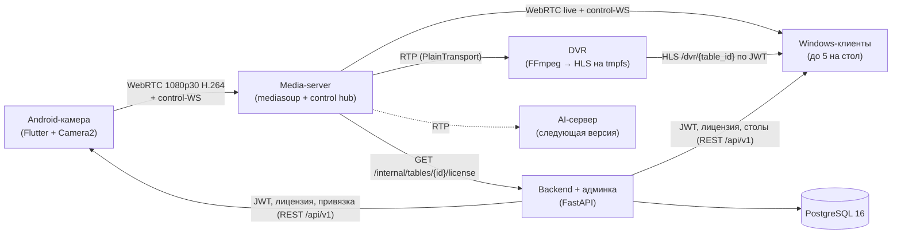

# ТЗ для Claude Code: PokerCam v2

Oct 28, 2026 · @Alisher

## 1. Как работать с этим ТЗ

Это ТЗ — единственный источник требований для Claude Code. Экспортируйте его в Markdown, положите в репозиторий как `docs/SPEC.md`, а блок ниже сохраните в корне как `CLAUDE.md`. Разработка идёт этапами из раздела 12: один этап — одна сессия Claude Code, одна ветка, проверка по критериям приёмки.

Если код из прошлой версии (`poker_cam_full`) сохранился, кладите его в репозиторий как есть: этап 0 — аудит этого кода против ТЗ, а не переписывание с нуля.

```markdown
# CLAUDE.md — PokerCam

## Что это
Система видеонаблюдения за раздачей карт на покерных столах:
Android-телефон над столом -> медиа-сервер -> до 5 Windows-клиентов на стол,
с перемоткой на 10 минут, удалённым управлением камерой и лицензированием.
Полные требования: docs/SPEC.md. При расхождении кода и SPEC — остановись и спроси.

## Как работать
- Работай по этапам из SPEC, раздел 12. Не начинай следующий этап без моего ОК.
- Перед кодом: план (какие файлы, какие решения), жди подтверждения.
- Этап закрыт, только когда выполнены все его критерии приёмки и `make test` зелёный.
- В конце этапа: обнови docs/CHANGELOG.md и раздел «Статус» в README.

## Жёсткие правила
- mediasoup: только официальный Device API (mediasoup-client / mediasoup_client_flutter).
  НИКОГДА не собирай SDP вручную — это уже ломало проект.
- Все сообщения между компонентами описаны в contracts/ (JSON Schema).
  Меняешь протокол — сначала схема, потом код во всех компонентах.
- Никаких секретов в git. Конфиги через .env, есть .env.example.
- Все строки UI через локализацию (ru, en). Ни одной захардкоженной строки.
- Логи — структурированный JSON с полями table_id, device_id, session_id.
- Новую зависимость добавляй, только объяснив зачем.
- Не удаляй и не переименовывай публичные API/сообщения без явного запроса.

## Команды
- make dev    — поднять backend + media-server + postgres в docker compose
- make test   — все тесты всех компонентов
- make lint   — линтеры (ruff, eslint, dart analyze)
```

## 2. Цели и рамки MVP

MVP = 10 столов × 1 камера × до 5 Windows-клиентов, 1080p30, перемотка на 10 минут, удалённое управление камерой, ежемесячная лицензия с 3-дневной отсрочкой. AI-распознавание карт в MVP не входит, но архитектура должна позволить подключить его без переделок.

**Первая версия (пилот)** — все функции MVP, но 1 стол × 1 телефон-камера × 1 Windows-клиент (решение 28.10.2026, раздел 14). Ограничения задаются настройками, а не кодом: `max_tables = 1` в лицензии клиента и `MAX_VIEWERS_PER_TABLE = 1` в media-server. Протокол и архитектура остаются рассчитанными на 10 × 5: переход к полному масштабу — смена настроек и нагрузочный тест.

**Целевые параметры**

| Параметр | Значение |
| --- | --- |
| Видео | 1920×1080, 30 fps, H.264, 3–4 Mbps |
| Задержка live (камера → экран) | ≤ 1 с в одной сети, ≤ 2 с через интернет |
| Перемотка | 10 минут назад, шаг 0,5 с |
| Столов на инсталляцию | до 10 (пилот: 1) |
| Клиентов на стол | до 5 (пилот: 1) |
| Непрерывная работа | ≥ 12 часов без перезапуска |
| ОС | Android 10+ (камера), Windows 10/11 x64 (клиент) |
| Языки | русский, английский |

**Входит в MVP**

- Android-приложение камеры с ручными настройками и телеметрией
- Медиа-сервер (SFU) + сервис DVR-буфера
- Windows-клиент: live, перемотка, горячие клавиши, управление камерой, статус устройства
- Backend: клиенты, столы, устройства, лицензии, привязка телефона к столу, простая веб-админка
- White-label на уровне сборки: название, логотип, цвета
- Деплой через docker compose на VPS или локальный сервер клуба

**Не входит в MVP**

- Распознавание карт, аналитика раздач, статистика игроков
- Долговременная запись видео (только 10-минутный буфер)
- iOS, macOS, веб-клиент
- Онлайн-оплата: клиент платит наличными, администратор отмечает оплату в админке кнопкой «+1 месяц»

## 3. Архитектура и ключевые решения

Система из четырёх сервисов: телефон публикует WebRTC-поток в mediasoup, mediasoup раздаёт его клиентам и параллельно отдаёт копию в DVR-сервис, backend выдаёт токены и решает, кому можно подключаться.



Пунктиром — AI-сервер следующей версии: он подключится к тому же RTP-выходу, что и DVR.

| # | Решение | Почему |
| --- | --- | --- |
| ADR-1 | Стек v1 сохраняем: Flutter (Android + Windows), mediasoup на Node.js, FastAPI + PostgreSQL | Код уже написан; один язык UI на оба клиента |
| ADR-2 | WebRTC только через Device API mediasoup; ICE по UDP с fallback на TCP, опционально TURN (coturn) | Ручной SDP уже ломал проект; TCP нужен для клубов с закрытым Wi-Fi |
| ADR-3 | DVR-буфер живёт в RAM сервера (tmpfs), а не в RAM клиента | flutter\_webrtc не отдаёт закодированные кадры, а 10 мин раскодированного 1080p ≈ 150 ГБ. Серверный буфер ≈ 300 МБ на стол, общий для 5 клиентов, и поздно подключившийся клиент тоже видит историю |
| ADR-4 | Ключевой кадр каждую 1 с (GOP = 30) | Сегменты DVR по 1 с и быстрый старт новых клиентов |
| ADR-5 | Один APK на бренд, а не на стол; телефон привязывается к столу через QR-код | Убирает ручную сборку под каждый стол; замена телефона = повторная привязка за 1 минуту |
| ADR-6 | Команды камеры и телеметрия идут через отдельный control-WebSocket в media-server, в той же комнате, что и видео | Комната = стол, авторизация общая, одна точка отказа меньше |
| ADR-7 | Лицензия зашита в короткоживущий JWT от backend; media-server проверяет его при входе и каждые 10 мин | Блокировка работает на сервере, её нельзя обойти патчем клиента |

ADR-3 — отклонение от исходного ТЗ (там буфер у клиента). Требование «смотреть назад 10 минут» выполняется полностью; если клиент настаивает на буфере на ПК, см. раздел 13.

## 4. Стек и структура репозитория

Один монорепозиторий, общий Flutter-пакет для двух клиентов и общие контракты в JSON Schema.

| Компонент | Технологии |
| --- | --- |
| Android-камера | Flutter 3.x, BLoC, flutter\_webrtc, mediasoup\_client\_flutter, нативный Kotlin-плагин для Camera2 |
| Windows-клиент | Flutter 3.x (Windows), BLoC, flutter\_webrtc для live, media\_kit (libmpv) для перемотки |
| Media-server | Node.js 24 LTS (было 20: его поддержка закончилась в апреле 2026, замена согласована 28.10.2026), TypeScript, mediasoup 3.x, ws |
| DVR-сервис | FFmpeg (remux без перекодирования), сегменты fMP4 по 1 с, tmpfs; управляется из media-server |
| Backend | Python 3.12, FastAPI, SQLAlchemy 2, Alembic, PostgreSQL 16, PyJWT (Ed25519) |
| Админка | Серверные шаблоны Jinja2 + HTMX внутри backend |
| Инфраструктура | Docker compose, Caddy (HTTPS), опционально coturn |
| Контракты | JSON Schema → генерация типов для Dart, TS, Python (quicktype / datamodel-codegen) |

```
pokercam/
├── CLAUDE.md
├── Makefile
├── docker-compose.yml
├── .env.example
├── docs/
│   ├── SPEC.md
│   └── CHANGELOG.md
├── contracts/                 # JSON Schema всех сообщений и REST-моделей
│   ├── ws/control/*.json
│   ├── ws/signaling/*.json
│   └── scripts/codegen.sh
├── backend/                   # FastAPI
│   ├── app/{api,models,services,admin}/
│   ├── migrations/
│   └── tests/
├── media-server/              # mediasoup + control hub + DVR manager
│   ├── src/{rooms,signaling,control,dvr,auth}/
│   └── tests/
├── apps/
│   ├── shared/                # Flutter-пакет: контракты, сетевой слой, l10n, тема бренда
│   ├── camera_android/        # Flutter + android/ с Kotlin-плагином camera2_control
│   └── viewer_windows/
├── branding/                  # бренды: name, logo, colors, applicationId
│   └── default/brand.json
└── tools/
    └── load_test/             # имитация 10 столов × 5 клиентов
```

## 5. Контракты: данные, REST, WebSocket

Все структуры ниже сначала описываются в `contracts/` как JSON Schema, типы для Dart, TS и Python генерируются из них. Ручное дублирование моделей запрещено.

### 5.1 Модель данных (PostgreSQL)

| Таблица | Ключевые поля |
| --- | --- |
| `brand` | id, app\_name, logo\_url, colors (json), android\_application\_id |
| `client` | id, name, brand\_id, activation\_key\_hash |
| `license` | id, client\_id, paid\_until, max\_tables, suspended (bool) |
| `poker_table` | id, client\_id, name, number |
| `device` | id, client\_id, table\_id (nullable), model, android\_id\_hash, paired\_at, last\_seen\_at, revoked\_at |
| `viewer` | id, client\_id, machine\_id\_hash, name, last\_seen\_at |
| `pairing_code` | code (6 цифр), table\_id, expires\_at, used\_at |
| `admin_user` | id, email, password\_hash |
| `audit_log` | id, actor, action, entity, entity\_id, payload (json), created\_at |

Статус лицензии вычисляется, а не хранится:

- `active` — сейчас ≤ paid\_until
- `grace` — paid\_until < сейчас ≤ paid\_until + 3 дня
- `expired` — сейчас > paid\_until + 3 дня
- `suspended` — флаг suspended = true (ручная блокировка, перекрывает всё)

Оплата открывает доступ на месяц: «+1 месяц» сдвигает paid\_until на один календарный месяц от paid\_until, пока доступ работает (включая 3 дня отсрочки: опоздание с оплатой не сдвигает дату расчёта), иначе — от момента оплаты. Ключ клуба и привязка телефона бессрочны, пока их не отозвали: продление не требует ничего вводить на ПК и телефоне.

### 5.2 REST API backend (`/api/v1`)

| Метод и путь | Кто вызывает | Что делает |
| --- | --- | --- |
| `POST /viewer/activate` | Windows-клиент | Ключ клуба + machine\_id → refresh-токен клиента |
| `POST /device/pair` | Телефон | 6-значный код со стола → refresh-токен устройства, table\_id |
| `POST /auth/token` | Оба | refresh-токен → access JWT (срок — настройка `ACCESS_TOKEN_TTL`, по умолчанию 12 ч, см. 9.1) |
| `GET /license` | Оба | Статус, paid\_until, grace\_until (это и есть check\_license) |
| `GET /tables` | Windows-клиент | Столы клуба и онлайн-статус камер |
| `POST /tables/{id}/pairing-code` | Windows-клиент | Новый код привязки, живёт 5 мин, + payload для QR |
| `GET /brand` | Оба | Название, логотип, цвета |
| `GET /internal/tables/{id}/license` | Media-server | Свежий статус лицензии; закрыт сетью docker, не публикуется наружу |

Access JWT подписан Ed25519; media-server проверяет его публичным ключом без запроса в backend. Claims: `sub`, `role` (camera | viewer), `client_id`, `table_id`, `lic` (active | grace), `exp`.

### 5.3 Control-WebSocket (media-server)

Конверт каждого сообщения: `{type, id, ts, table_id, payload}`. Сигнальные сообщения mediasoup (join, getRouterRtpCapabilities, createTransport, connectTransport, produce, consume, resume) идут по тому же соединению, но описаны отдельной группой схем.

| type | Направление | payload |
| --- | --- | --- |
| `camera.capabilities` | камера → клиенты | для каждого параметра: supported, min, max, step, current |
| `camera.set` | клиент → камера | param, value |
| `camera.ack` | камера → инициатор | id запроса, ok, applied\_value, error |
| `camera.state` | камера → все клиенты | текущие значения + кто менял последним |
| `device.telemetry` | камера → клиенты, раз в 5 с | battery\_pct, charging, temp\_c, thermal\_status, network (type, rssi, rtt\_ms, uplink\_kbps), stream (bitrate\_kbps, fps, dropped\_frames) |
| `device.alert` | камера → клиенты | kind: low\_battery, overheating, bitrate\_reduced, network\_poor; level; message\_key |
| `stream.status` | сервер → клиенты | live, reconnecting, offline + since |
| `license.status` | сервер → все | active, grace, blocked + grace\_until |
| `dvr.info` | сервер → клиент | available\_from, available\_to, playlist\_url |
| `ai.detection` | AI → клиенты (резерв) | ts, cards: rank, suit, confidence, bbox |

Параметры камеры (`param`): focus, iso, exposure, brightness, contrast, white\_balance, zoom. Одновременные изменения: последний выигрывает, всем рассылается `camera.state`.

## 6. Android-приложение камеры

Приложение превращает телефон в камеру стола: привязка по QR, предстартовая проверка, трансляция 1080p30 и выполнение команд с ПК. Главный технический риск — ручное управление Camera2 поверх захвата flutter\_webrtc; его закрывают спайком в этапе 1 до остальной работы.

### 6.1 Экраны

1. **Привязка** — сканировать QR с ПК или ввести 6-значный код. Показывается только у непривязанного устройства.
2. **Предстартовая проверка** — список параметров камеры с отметкой «поддерживается / нет», разрешение 1080p, кодек H.264, разрешения Android, статус лицензии. Кнопка «Начать трансляцию» активна, только если обязательные пункты зелёные.
3. **Трансляция** — превью, индикатор LIVE, битрейт, fps, заряд, температура, сеть. Баннеры предупреждений поверх превью.

### 6.2 Камера и управление

- Нативный Kotlin-плагин `camera2_control` читает `CameraCharacteristics` и применяет параметры к `CaptureRequest` того же сеанса, который использует flutter\_webrtc.
- Варианты спайка, по порядку: (а) доступ к сеансу Camera2Capturer flutter\_webrtc; (б) форк flutter\_webrtc с хуком на CaptureRequest; (в) собственный VideoCapturer на Camera2, отдающий кадры в WebRTC-источник. Выбранный вариант записать в docs/CHANGELOG.md.

| Параметр | Как реализуется в Camera2 | Проверка поддержки |
| --- | --- | --- |
| Focus | AF\_MODE\_OFF + LENS\_FOCUS\_DISTANCE | LENS\_INFO\_MINIMUM\_FOCUS\_DISTANCE > 0 |
| ISO | AE\_MODE\_OFF + SENSOR\_SENSITIVITY | MANUAL\_SENSOR, SENSITIVITY\_RANGE |
| Exposure | SENSOR\_EXPOSURE\_TIME (≤ 1/30 с, чтобы держать 30 fps) | EXPOSURE\_TIME\_RANGE |
| Brightness | CONTROL\_AE\_EXPOSURE\_COMPENSATION (в авто-режиме) | AE\_COMPENSATION\_RANGE |
| Contrast | TONEMAP\_MODE\_CONTRAST\_CURVE | AVAILABLE\_TONE\_MAP\_MODES |
| White balance | AWB-пресеты или ручная цветовая температура | AWB\_AVAILABLE\_MODES, MANUAL\_POST\_PROCESSING |
| Zoom | CONTROL\_ZOOM\_RATIO (API 30+) или SCALER\_CROP\_REGION | ZOOM\_RATIO\_RANGE / MAX\_DIGITAL\_ZOOM |

- Неподдерживаемые параметры приходят в `camera.capabilities` как `supported: false`, клиент их блокирует.
- Последние значения сохраняются на устройстве и восстанавливаются после переподключения и перезапуска.

### 6.3 Видео

- 1920×1080, 30 fps, H.264 (аппаратный кодер), maxBitrate 4 Mbps, degradationPreference = maintain-resolution.
- Приложение работает как foreground service: экран не гаснет, wake lock, запрос на исключение из оптимизации батареи.

### 6.4 Температура, батарея, сеть

| Событие | Действие |
| --- | --- |
| Thermal status MODERATE или батарея > 42 °C | Битрейт 3 Mbps, `device.alert` overheating (warning) |
| Thermal status SEVERE | Битрейт 2 Mbps, alert (critical) |
| Остыл и держится 2 мин | Вернуть 4 Mbps (гистерезис, без «пилы») |
| Заряд < 15 % без зарядки | Баннер на телефоне + `device.alert` low\_battery; повтор при 5 % |
| Потеря сети | Баннер «Нет связи», переподключение с паузами 1-2-4-8-10 с, бесконечно; после восстановления — новый transport, produce, восстановление настроек |
| Устройство отвязано в админке или заменено | Трансляция останавливается, экран привязки |

### 6.5 Критерии приёмки

- [ ] Привязка нового телефона к столу через QR занимает < 1 мин, старый телефон этого стола автоматически отключается
- [ ] Каждый поддерживаемый параметр меняется с ПК и виден в картинке ≤ 1 с
- [ ] Неподдерживаемые параметры честно помечены на экране проверки и в клиенте
- [ ] 1080p30 держится 4 часа подряд на эталонном телефоне без падения fps ниже 25
- [ ] Выключение Wi-Fi на 30 с → трансляция сама восстанавливается ≤ 15 с после возврата сети
- [ ] Перегрев снижает битрейт и шлёт предупреждение (проверка через эмуляцию thermal status)

## 7. Media-server и DVR-буфер

Одна комната mediasoup = один стол: один producer от камеры, до 5 consumer-клиентов и один служебный consumer для DVR. Видео нигде не перекодируется, поэтому CPU-нагрузка низкая, а узкое место — исходящий канал.

### 7.1 Комнаты и доступ

- Пул воркеров mediasoup по числу ядер, комнаты распределяются round-robin (как в v1).
- Вход в комнату только с валидным JWT; роль и table\_id берутся из токена, а не из сообщения.
- Новый producer камеры того же стола заменяет старый (замена телефона), клиенты переключаются без переподключения.
- Клиент сверх `MAX_VIEWERS_PER_TABLE` (5; в пилоте 1) получает ошибку `room_full`, в клиенте показывается понятное сообщение.
- Каждые 10 мин и при старте комнаты сервер запрашивает `GET /internal/tables/{id}/license`. Статус `expired` или `suspended` → закрыть producer и consumers, разослать `license.status: blocked`. Статус `grace` → поток идёт, всем рассылается предупреждение с датой блокировки.

### 7.2 DVR

1. При появлении producer media-server создаёт PlainTransport-consumer и запускает FFmpeg, который читает RTP по SDP-файлу.
2. FFmpeg пишет HLS без перекодирования: `-c copy -f hls -hls_time 1 -hls_list_size 600 -hls_segment_type fmp4 -hls_flags delete_segments+program_date_time` в `/dvr/{table_id}/` на tmpfs.
3. Чтобы сегменты были ровно по 1 с, media-server раз в секунду вызывает `consumer.requestKeyFrame()` у DVR-consumer.
4. Плейлист и сегменты отдаются по HTTP: `GET /dvr/{table_id}/index.m3u8`, доступ по тому же JWT (роль viewer, совпадающий table\_id).
5. FFmpeg перезапускается при падении и при смене producer; разрыв помечается `EXT-X-DISCONTINUITY`.

Емкость: 4 Mbps × 600 с ≈ 300 МБ на стол, 10 столов ≈ 3 ГБ tmpfs. Сервер — от 8 ГБ RAM.

### 7.3 Канал

| Поток | Расчёт | Итого |
| --- | --- | --- |
| Входящий (камеры) | 10 столов × 4 Mbps | 40 Mbps |
| Исходящий live | 10 × 5 клиентов × 4 Mbps | 200 Mbps |
| Исходящий DVR (пиково) | все клиенты одновременно в перемотке | до 200 Mbps |

Для полной нагрузки нужен канал не меньше 300 Mbps; для 1–3 столов хватает обычного VPS на 100 Mbps.

### 7.4 Критерии приёмки

- [ ] Нагрузочный тест `tools/load_test`: 10 столов × 5 клиентов, 1 час, без потерь кадров на сервере и без роста памяти (пилот: 1 стол × 1 клиент, 12 часов)
- [ ] DVR-плейлист всегда содержит 590–600 сегментов после 10 минут работы
- [ ] Убийство процесса FFmpeg → буфер продолжает писаться ≤ 5 с, клиенты видят разрыв, а не ошибку
- [ ] Лицензия переведена в `expired` в админке → поток стола блокируется ≤ 10 мин без участия клиентов
- [ ] Запрос DVR-плейлиста чужого стола или без токена → 401/403

## 8. Windows-клиент

Клиент показывает live через WebRTC, а при любой перемотке незаметно переключается на плеер DVR-плейлиста; кнопка LIVE возвращает на WebRTC. Одно окно = один стол, несколько столов = несколько окон.

### 8.1 Экраны

1. **Активация** — ввод ключа клуба при первом запуске, затем check\_license.
2. **Выбор стола** — список столов с онлайн-статусом камеры; кнопка «Привязать телефон» показывает QR и 6-значный код.
3. **Просмотр** — слева видео, справа панель управления (как в исходном ТЗ).

### 8.2 Область видео

- Live: `RTCVideoView` из flutter\_webrtc. Перемотка: `media_kit` (libmpv) открывает `/dvr/{table_id}/index.m3u8`.
- Время в DVR сопоставляется с live по `EXT-X-PROGRAM-DATE-TIME`, поэтому «−5 с» — это ровно 5 секунд от реального момента.
- Live-точка DVR отстаёт от реального live примерно на 1,5 с; первый шаг назад из live может прыгнуть на эту величину. Это допустимо, отставание показывается на индикаторе.
- Пауза из live: кадр замораживается сразу (снимок трека), а DVR-плеер встаёт на момент нажатия.
- В режиме перемотки видео идёт дальше в реальном темпе с задержкой; пользователь остаётся на своей точке, пока не нажмёт LIVE.
- Индикаторы: красный LIVE или жёлтый «−02:35»; шкала на 10 минут с доступным диапазоном буфера.

### 8.3 Горячие клавиши

| Клавиша | Действие |
| --- | --- |
| → | +1 с |
| ← | −1 с |
| ↑ | +0,5 с |
| ↓ | −0,5 с |
| Shift + ← | −10 с |
| Space | Пауза / продолжить |
| L | Вернуться в LIVE |

Шаги вперёд не уходят дальше live-точки, назад — дальше начала буфера. Клавиши работают, когда фокус в окне просмотра и не в поле ввода.

### 8.4 Панель управления

- Ползунки и переключатели «Авто / Ручной» строятся по `camera.capabilities`; неподдерживаемое — неактивно с подсказкой.
- Отправка `camera.set` с задержкой 100 мс при движении ползунка; ошибка из `camera.ack` — тост и откат ползунка.
- Кнопка «Сбросить по умолчанию».
- Статус устройства: заряд и зарядка, температура, сеть (тип, сигнал, RTT), битрейт, fps, состояние соединения.
- Предупреждения `device.alert` — тост + журнал последних 50 событий.
- Лицензия: `grace` — жёлтый баннер с датой блокировки; `blocked` — вместо видео сообщение и контакты продавца.

### 8.5 Сбои

- Потеря связи с сервером — оверлей «Переподключение…», повторы 1-2-4-8-10 с, после восстановления выбранный стол и режим (live/перемотка) сохраняются.
- Камера стола офлайн — заглушка «Камера не в сети» с временем последнего сигнала; DVR остаётся доступен до конца буфера.

### 8.6 Критерии приёмки

- [ ] Все 7 горячих клавиш работают; погрешность позиции ≤ 0,1 с относительно ожидаемой
- [ ] Переход live → перемотка → LIVE без чёрного экрана дольше 300 мс
- [ ] 5 клиентов на одном столе одновременно, у каждого независимая перемотка (пилот: 1 клиент; проверяется при переходе к полному масштабу)
- [ ] 8 часов работы без утечки памяти (рост RSS < 200 МБ)
- [ ] Установщик `.exe` (Inno Setup) или MSIX ставится на чистую Windows 10 без ручных зависимостей

## 9. Backend: лицензии, привязка, админка

Backend — единственный источник правды о клиентах, столах, устройствах и оплате; видео через него не идёт. Модель данных и API — в разделе 5.

### 9.1 Лицензия

- check\_license = `GET /license`, вызывается клиентом и камерой при запуске и раз в час.
- Access JWT живёт 12 ч (настройка `ACCESS_TOKEN_TTL`) и обновляется раз в час: падение backend до 12 ч не останавливает работающие столы. Срок доступа клиента — месяц лицензии, а не срок токена: блокирует media-server по статусу лицензии (7.1).
- Неуплата: после paid\_until 3 дня статус `grace` (всё работает, везде баннер с датой), затем `expired` — media-server блокирует поток (раздел 7.1).
- Продление в админке кнопкой «+1 месяц» или датой; разблокировка срабатывает при следующей проверке media-server (≤ 10 мин) или сразу кнопкой «Применить сейчас».
- `max_tables` ограничивает число столов клиента; лишний стол нельзя создать.

### 9.2 Привязка телефона

1. В Windows-клиенте «Привязать телефон» → `POST /tables/{id}/pairing-code` → QR + код, живёт 5 мин, одноразовый.
2. Телефон сканирует QR → `POST /device/pair` → refresh-токен устройства.
3. Если у стола уже был телефон, он помечается `revoked_at`, его токены перестают обновляться, а media-server выключает его producer.

Защита: не больше 5 попыток ввода кода в минуту с одного IP; ключ клуба и коды в БД только как хэш.

### 9.3 Веб-админка (`/admin`)

- Вход по email и паролю (argon2), одна роль «администратор» в MVP.
- Бренды, клиенты, столы: создание, редактирование, перевыпуск ключа активации.
- Лицензии: дата оплаты, «+1 месяц», блокировка, текущий вычисленный статус.
- Устройства и Windows-клиенты: модель, стол, последний онлайн, отзыв доступа.
- Журнал аудита всех изменений с фильтром по клиенту.
- Скрипт `make seed`: демо-бренд, клиент, 2 стола, админ из .env.

### 9.4 Критерии приёмки

- [ ] Покрытие тестами вычисления статуса лицензии — все 4 статуса и границы (ровно paid\_until, ровно +3 дня)
- [ ] Повторное использование кода привязки и просроченный код → 400 с понятной ошибкой
- [ ] Каждое изменение в админке пишет запись в audit\_log
- [ ] OpenAPI-схема `/docs` совпадает с contracts/ (проверка в CI)

## 10. White-label и подготовка под AI

Бренд меняется одной папкой в `branding/` и одной командой сборки; AI подключается к уже существующему RTP-выходу без изменений в камере и клиенте.

### 10.1 White-label

- `branding/<brand>/brand.json`: app\_name, android\_application\_id, windows\_app\_id, цвета (primary, secondary, background, accent), путь к логотипу и иконке.
- `make build BRAND=<brand>` собирает APK и Windows-установщик: подменяет название, иконку, applicationId и тему. Android — через Flutter flavors, Windows — через параметры Runner и Inno Setup.
- Цвета и логотип также приходят из `GET /brand`, чтобы мелкие правки не требовали пересборки.
- В коде нет ни одной строки с именем бренда, кроме `branding/default`.

### 10.2 Подготовка под AI

- Media-server умеет по флагу `AI_ENABLED` создать для стола второй PlainTransport-consumer и отдать RTP на адрес AI-сервера.
- Сообщение `ai.detection` уже описано в contracts/ и проходит через control-WebSocket к клиентам; клиент в MVP его игнорирует.
- Каждый кадр DVR привязан к времени через program-date-time, поэтому распознанные карты можно сопоставить с моментом в перемотке.
- В MVP AI-сервер не пишется; достаточно заглушки `tools/fake_ai`, которая раз в секунду шлёт тестовое `ai.detection`.

## 11. Надёжность, тесты, деплой

Главное требование — многочасовой турнир без ручных вмешательств: всё, что может упасть, перезапускается само и восстанавливает состояние.

### 11.1 Надёжность

- Все сервисы в docker compose с `restart: unless-stopped` и healthcheck.
- Перезапуск media-server: камеры и клиенты переподключаются сами ≤ 20 с; буфер DVR этого стола начинается заново (допустимо, показывается разрыв).
- Логи JSON в stdout; `GET /health` у backend и media-server; метрики Prometheus (комнаты, клиенты, битрейт по столам, размер DVR) — желательно, не блокирует MVP.

### 11.2 Тестирование

| Уровень | Что покрывается | Инструмент |
| --- | --- | --- |
| Unit | Статус лицензии, привязка, разбор сообщений, логика перемотки (offset, границы) | pytest, vitest, flutter test |
| Контракты | Каждое сообщение валидируется по JSON Schema на обеих сторонах | ajv, jsonschema, тесты в shared |
| Интеграция | backend + media-server + фейковая камера (FFmpeg с тестовым видео через mediasoup-client в Node) | docker compose + pytest |
| Нагрузка | 10 столов × 5 клиентов, 1 час | tools/load\_test |
| Ручной прогон | Чек-лист на реальном телефоне и ПК: все критерии приёмки разделов 6 и 8 | docs/QA\_CHECKLIST.md |

CI (GitHub Actions): lint + unit + контракты на каждый push; интеграция на PR в main.

### 11.3 Деплой

- Вариант A — VPS: Ubuntu 22.04, 4 vCPU, 8 ГБ RAM, канал по расчёту из 7.3, открытые UDP-порты RTC (диапазон в .env).
- Вариант B — мини-ПК в клубе: тот же compose, задержка ниже, интернет нужен только для проверки лицензии.
- `make deploy` = git pull + `docker compose up -d --build` + миграции Alembic.
- В README пошаговая инструкция с нуля до работающего стола, проверенная на чистом сервере.

## 12. Этапы и промпты для Claude Code

10 этапов, строго по порядку; этап 1 — проверка главного риска на реальном телефоне, до него остальное не пишется. Каждый этап начинайте в новой сессии Claude Code в plan mode.

| Этап | Результат | Готово, когда |
| --- | --- | --- |
| 0. Фундамент | Монорепо, CLAUDE.md, compose, contracts + codegen, CI; аудит кода v1 | `make dev` и `make test` проходят, есть docs/AUDIT.md |
| 1. Спайк Camera2 | Мини-приложение: flutter\_webrtc + ручные ISO/фокус/зум | ISO и фокус меняются во время трансляции на реальном телефоне |
| 2. Backend | Модели, лицензии, привязка, JWT, админка | Критерии 9.4 |
| 3. Media-server | Комнаты, JWT, control hub, лицензия, фейковая камера | 5 клиентов-ботов получают поток фейковой камеры |
| 4. DVR | FFmpeg-буфер, HLS по JWT, keyframe 1 с | Критерии 7.4 |
| 5. Android | Все экраны и функции раздела 6 | Критерии 6.5 |
| 6. Windows: live | Активация, столы, привязка, live, панель управления | Камера управляется с ПК |
| 7. Windows: DVR | Перемотка, горячие клавиши, индикаторы | Критерии 8.6 |
| 8. White-label | Сборка по BRAND, установщики | Два бренда собираются одной командой |
| 9. Приёмка | Нагрузочный тест, 8-часовой прогон, QA-чек-лист, README деплоя | Все чек-листы зелёные |

### Шаблон промпта на каждый этап

```
Прочитай CLAUDE.md и docs/SPEC.md. Делаем этап N «<название>» из раздела 12.
1. Сначала план: какие файлы создашь или изменишь, какие решения принимаешь
   и почему, какие риски видишь. Жди моего ОК.
2. Если для этапа нужно изменить протокол — сначала contracts/, потом код.
3. После реализации прогони make lint и make test, проверь каждый критерий
   приёмки этапа и отчитайся по каждому: выполнен / не выполнен / нельзя
   проверить без устройства (тогда опиши, как проверить мне руками).
4. Обнови docs/CHANGELOG.md и раздел «Статус» в README.
```

### Дополнения к шаблону по этапам

- **Этап 0:** «Если в репозитории есть код v1, не переписывай его. Сравни с SPEC и запиши в docs/AUDIT.md по каждому компоненту: что совпадает, что расходится, что сломано, что переиспользуем. Особо проверь, нет ли где-то ручной сборки SDP.»
- **Этап 1:** «Это спайк, не продакшн-код: отдельный пакет `spikes/camera2_webrtc`. Проверь варианты из раздела 6.2 по порядку и остановись на первом рабочем. Итог — короткий отчёт с выбранным вариантом и списком параметров, которые реально применились.»
- **Этап 3:** «Сделай `tools/fake_camera` на Node с mediasoup-client и FFmpeg, публикующий тестовое видео 1080p30 как настоящая камера, и `tools/fake_viewer`. Ими же потом будет нагрузочный тест.»
- **Этап 4:** «Покажи итоговую команду FFmpeg и SDP-файл в отчёте. Тест: через 11 минут работы в плейлисте 590–600 сегментов, а самый старый сегмент удалён.»
- **Этап 7:** «Логику времени перемотки (offset от live, границы буфера, сопоставление по program-date-time) вынеси в чистый Dart-класс без UI и покрой unit-тестами до того, как подключать плеер.»
- **Этап 9:** «Запусти нагрузочный тест на 1 час, приложи графики памяти и CPU media-server. Составь docs/QA\_CHECKLIST.md из всех критериев приёмки для ручной проверки.»

## 13. Открытые вопросы

- [ ] DVR на сервере (ADR-3) устраивает заказчика, или буфер обязательно должен быть на ПК? Если на ПК — Windows-клиент придётся получать поток вторым каналом (RTSP/SRT) и писать нативный буфер, это +2–3 недели.
- [ ] Где будет стоять сервер: VPS или мини-ПК в клубе? От этого зависит задержка и требования к каналу.
- [ ] Эталонная модель телефона: какой Android-телефон считаем стандартным? Ручные ISO и фокус поддерживают не все.
- [ ] Кто может менять камеру, если подключено 5 клиентов: все (последний выигрывает) или только «главный» оператор? (В пилоте один клиент — вопрос отложен.)
- [ ] Клиенты смотрят из клуба или удалённо через интернет? Если удалённо — нужен TURN-сервер.
- [ ] Нужен ли один экран со всеми столами сразу (мультивью) или хватит отдельных окон? (В пилоте один стол — вопрос отложен.)

## 14. Решения после утверждения ТЗ

| Дата | Решение |
| --- | --- |
| 28.10.2026 | Node.js 24 LTS вместо 20 (поддержка Node 20 закончилась в апреле 2026) |
| 28.10.2026 | Кода v1 нет, проект начат с нуля |
| 28.10.2026 | Первая версия — пилот: все функции MVP на 1 стол × 1 телефон × 1 ПК (раздел 2) |
| 28.10.2026 | Оплата наличными, доступ на месяц с продлением кнопкой «+1 месяц», после окончания 3 дня отсрочки, затем блокировка (5.1, 9.1) |
| 28.10.2026 | Access JWT — 12 ч с обновлением раз в час (9.1), а не 15 мин (5.2): срок доступа клиента задаёт лицензия |
| 28.10.2026 | Этап 2: claim `table_id` необязателен — токен Windows-клиента без стола годится только для REST (список столов), в комнату media-server без `table_id` не пускают; токен на стол клиент получает, передав `table_id` в `POST /auth/token` |
| 28.10.2026 | Этап 2: `/api/v1/internal/*` закрыты заголовком `X-Internal-Token` (а не только сетью docker); media-server берёт публичный ключ JWT из `GET /api/v1/internal/jwt-key` и проверяет токены сам |
| 28.10.2026 | Этап 2: неоплаченный клиент создаётся сразу заблокированным; ключ клуба показывается один раз, в БД только хэш; повторный ввод ключа на отозванном ПК возвращает ему доступ — чтобы закрыть ПК насовсем, ключ перевыпускают |
| 28.10.2026 | Этап 3: фейковая камера и зрители (`tools/`) — headless Chromium (Playwright) с mediasoup-client, а не Node + FFmpeg: в Node нет WebRTC-стека для mediasoup-client без нативных модулей, а Chromium даёт тот же браузерный WebRTC и встроенную тестовую камеру 1080p30. FFmpeg появится на этапе 4 (DVR) |
| 28.10.2026 | Этап 3: новые сообщения `signaling.new_producer` (камера начала публиковать — зрители делают consume без переподключения) и `signaling.consumer_closed` (поток камеры закончился) |
| 28.10.2026 | Этап 3: «камера онлайн» в `GET /tables` — это камера, подключённая к media-server: он сообщает о ней в `PUT /api/v1/internal/tables/{id}/camera`, а при своём старте сбрасывает все отметки (`POST /api/v1/internal/media-server/started`) |
| 28.10.2026 | Этап 3: публиковать может только телефон, привязанный к столу сейчас (`camera_device_id` в ответе лицензии); новая камера стола вытесняет старую (WebSocket закрывается с кодом 4001) |
| 28.10.2026 | Этап 3: кнопка «Применить сейчас» в карточке клиента — backend вызывает `POST /internal/tables/{id}/license-check` на media-server, и тот перепроверяет лицензию столов клиента сразу. Если backend недоступен, media-server оставляет последний известный статус |
| 28.10.2026 | Этап 3: у media-server один UDP- и TCP-порт на воркер mediasoup (WebRtcServer, `RTC_PORT_MIN`…`RTC_PORT_MAX`, по умолчанию 40000–40003), а не порт на каждый транспорт: на сервере открывается 4 порта, а не диапазон |
| 29.10.2026 | Этап 4: плейлист DVR собирает media-server, а не FFmpeg (отступление от флагов 7.2). Каждый запуск FFmpeg пишет в свою папку `r{N}/` с коротким плейлистом; media-server держит последние `DVR_SEGMENTS` (600) сегментов, удаляет старые файлы и отдаёт общий плейлист с `EXT-X-DISCONTINUITY` и своим init-сегментом на каждый запуск. Причина: FFmpeg с `append_list` после перезапуска перепривязывает старые сегменты к новому init-файлу и дописывает `EXT-X-ENDLIST` — при смене телефона история ломается, плеер останавливается |
| 29.10.2026 | Этап 4: DVR пишет только H.264 (кодек телефона, 6.1): fMP4 без перекодирования. Поток в VP8 идёт только в live, в лог — предупреждение |
| 29.10.2026 | Этап 4: доступ к `/dvr/{table_id}/…` — заголовок `Authorization: Bearer <access JWT>` (роль viewer, свой `table_id`); без токена 401, чужой стол или токен камеры 403, заблокированная лицензия 403 `license_blocked`, сегмент вне окна 404. Плеер Windows-клиента передаёт заголовок (media\_kit `httpHeaders`) |
| 29.10.2026 | Этап 4: `dvr.info` зрителям — при входе и раз в 5 с; FFmpeg перезапускается сразу после падения (повторные неудачи — с паузой до 5 с) и при зависании (5 с без сегментов, пока RTP идёт); пауза камеры завершает запуск, возобновление — новый запуск с разрывом |
| 29.10.2026 | Этап 4: нагрузочный тест `tools/load_test` готов; пилотный прогон 1 × 1 на 12 часов (7.4) делается на сервере пилота — в облачной сессии разработки он не помещается. В разработке прогнан 1 час, итоги — в CHANGELOG |
| 29.10.2026 | Этап 5: библиотека mediasoup для Flutter — `mediasfu_mediasoup_client` (поддерживаемый форк `mediasoup_client_flutter`, тот же Device API, MIT): исходная `mediasoup_client_flutter` заброшена в 2023 г. (Dart < 3, flutter_webrtc 0.9) и с Flutter 3.47 не собирается |
| 29.10.2026 | Этап 5: адрес media-server клиенты получают в ответе `POST /auth/token` — поле `media_url` из настройки `PUBLIC_MEDIA_URL`; при переезде сервера приложения узнают новый адрес при следующем обновлении токена |
| 29.10.2026 | Этап 5: `camera.ack` телефон отправляет, когда камера подтвердила настройку в `CaptureResult` (или через 2 с без подтверждения): время ответа на ПК — это время до изменения картинки (критерий 6.5) |
| 29.10.2026 | Этап 5: пока нет Windows-клиента, код привязки телефона выдаёт `python -m app.cli pairing-code "Клиент"`; установка сервера — `deploy/install.sh` (одна команда на чистой Ubuntu), проверяется в CI |
| 30.10.2026 | Этап 5: если камера во время трансляции 15 с ничего не отправляет (3 периода телеметрии подряд без кадров и байт) или у неё пропал сеанс захвата (камеру забрало другое приложение), телефон переподключается и открывает камеру заново — без участия человека (6.4) |
| 30.10.2026 | Этап 5: сквозной прогон на эмуляторе Android в CI открывает камеру в 640x480 (`CAPTURE_WIDTH` / `CAPTURE_HEIGHT` при сборке теста): у эмулятора нет H.264, VP8 кодируется программно. Приложение по умолчанию — 1080p30; критерий «1080p30 4 часа» (6.5) проверяется на эталонном телефоне |
| 30.10.2026 | Этап 5: до Windows-клиента компьютер клуба — страница `/viewer/` на media-server (вход по ключу активации, видео, телеметрия, настройки камеры со временем ответа, код привязки с QR). Backend разрешает CORS только адресу media-server (из `PUBLIC_MEDIA_URL`). Зависимости сборки страницы: mediasoup-client (Device API в браузере), esbuild (сборка), qrcode-generator (QR) — в образ попадает только готовый файл |
| 30.10.2026 | Этап 6: ID компьютера для активации — MachineGuid Windows (тот же после переустановки, один ПК в админке); refresh-токен — в диспетчере учётных данных Windows. «Другой стол в новом окне» — ещё один процесс программы с `--table <id>` |
| 30.10.2026 | Этап 6: при блокировке лицензии — «Обратитесь к продавцу» без контактов; поле контактов продавца в бренде — этап 8 (white-label). До установщика этапа 8 программа для ПК — zip (пре-релиз `viewer-windows`) |
